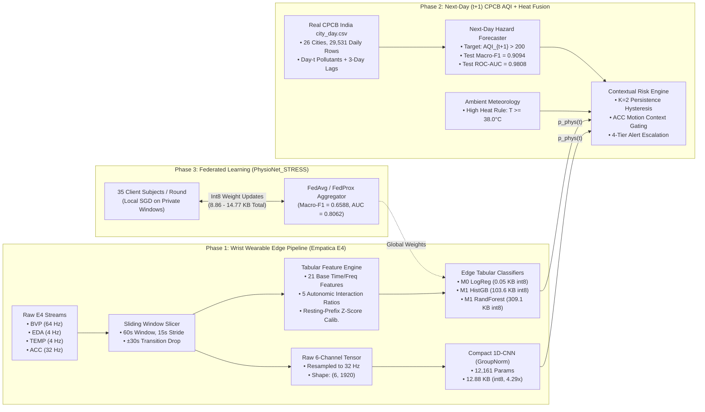
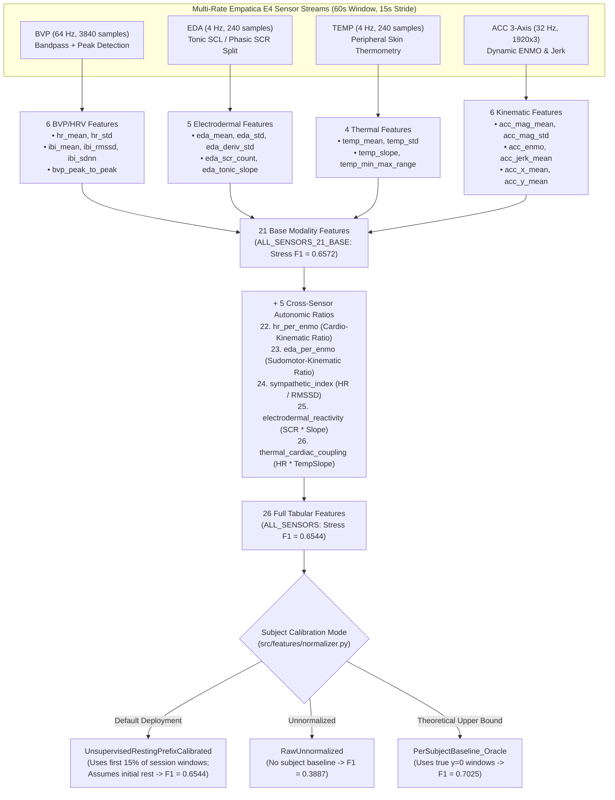
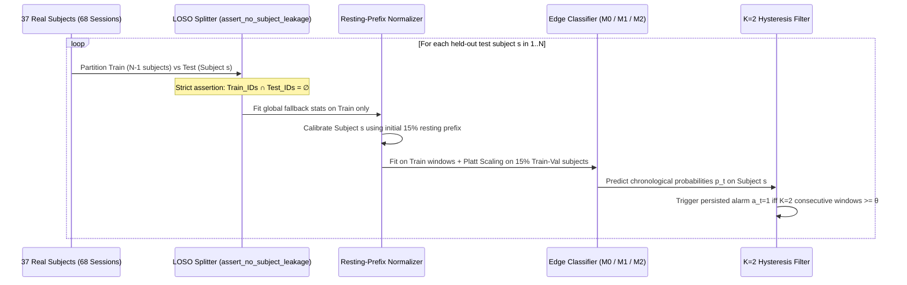
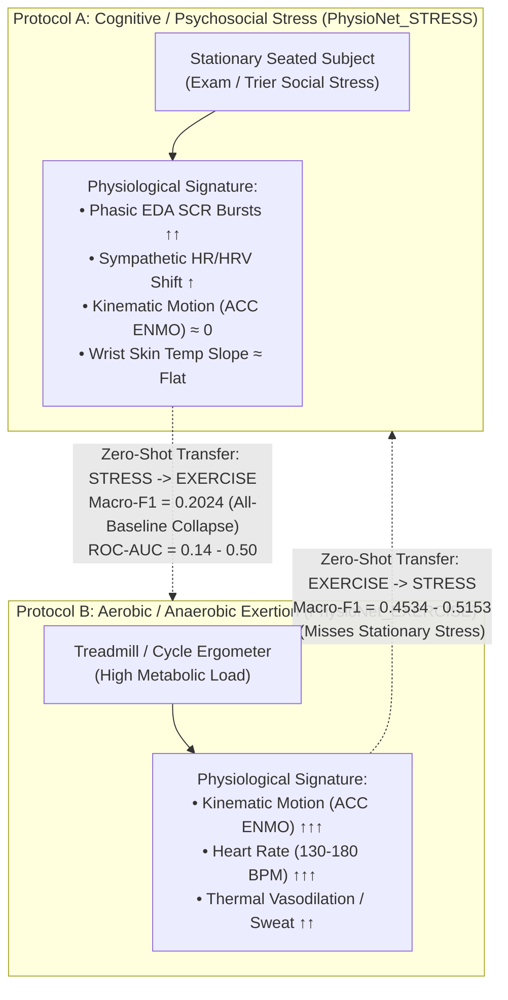
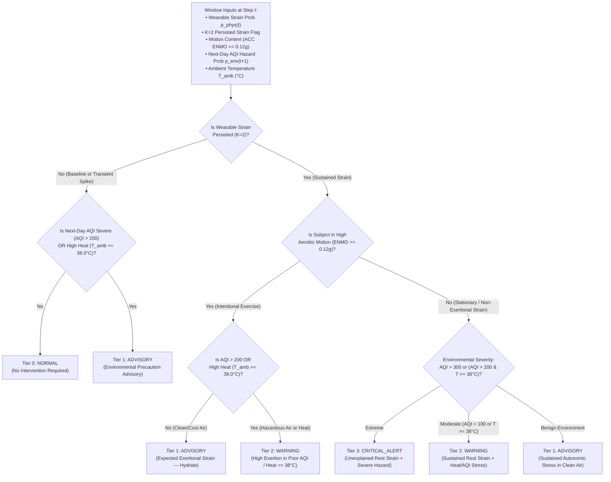
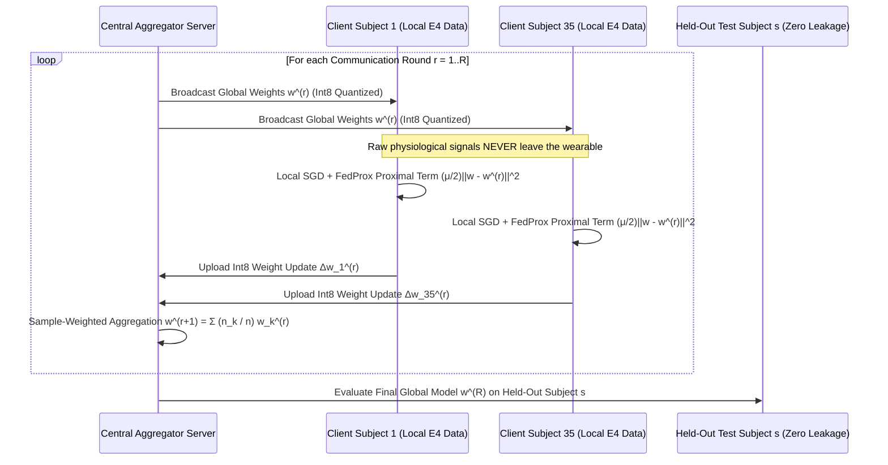

# Edge-Intelligent Personal Health Companion (UROP Research Benchmark)

[](https://www.python.org/downloads/)
[](https://opensource.org/licenses/MIT)
[](#reproducibility--verification)
[](https://physionet.org/content/wearable-device-dataset/1.0.0/)
[](#phase-2-next-day-t1-cpcb-india-aqi-forecasting--contextual-fusion)

A reproducible, subject-independent **Edge-AI + Causal Next-Day Environmental Hazard Forecasting + Privacy-Preserving Federated Learning** research benchmark for physiological strain detection on wrist-worn wearables (Empatica E4: `BVP 64 Hz`, `EDA 4 Hz`, `TEMP 4 Hz`, `ACC 32 Hz`).

> **Scope & Proxy Disclaimer**: Wearable models in this repository detect **acute autonomic and cardiorespiratory strain proxies** (cognitive/exam stress and aerobic/anaerobic physical exertion) rather than clinical heat-stroke or flood casualties. Hydrological/flood hazards are not modeled.

---

## Table of Contents
1. [Visual System Architecture & End-to-End Dataflow](#1-visual-system-architecture--end-to-end-dataflow)
2. [Signal Processing, 26-Feature Pipeline & Calibration Architecture](#2-signal-processing-26-feature-pipeline--calibration-architecture)
3. [Evaluation E1: Within-Dataset Subject-Independent LOSO Benchmark](#3-evaluation-e1-within-dataset-subject-independent-loso-benchmark)
4. [Evaluation E2: Cross-Protocol Domain Shift & Transfer Failure Analysis](#4-evaluation-e2-cross-protocol-domain-shift--transfer-failure-analysis)
5. [Evaluation E3: Sensor, Feature (21 vs 26), Window & Calibration Ablations](#5-evaluation-e3-sensor-feature-21-vs-26-window--calibration-ablations)
6. [Phase 1D: Multi-Model Edge Deployment & Int8 Quantization Profile](#6-phase-1d-multi-model-edge-deployment--int8-quantization-profile)
7. [Phase 2: Next-Day (`t+1`) CPCB India AQI Forecasting & Contextual Fusion](#7-phase-2-next-day-t1-cpcb-india-aqi-forecasting--contextual-fusion)
8. [Phase 3: Privacy-Preserving Federated Learning Benchmark](#8-phase-3-privacy-preserving-federated-learning-benchmark)
9. [Repository Structure & Reproducibility Commands](#9-repository-structure--reproducibility-commands)

---

## 1. Visual System Architecture & End-to-End Dataflow


### Interactive System Architecture Flowchart



---

## 2. Signal Processing, 26-Feature Pipeline & Calibration Architecture

Every 60-second window (with 15-second stride and $\pm 30\text{ s}$ protocol transition exclusion buffer) is processed along two parallel representations:
1. **26 Hand-Crafted Physiological Features (`M0` & `M1` Models)**: `21` base single-sensor features + `5` cross-sensor autonomic interaction ratios (`src/features/extractor.py`).
2. **6-Channel Raw Temporal Tensors (`M2 1D-CNN`)**: `(BVP, EDA, TEMP, ACC_x, ACC_y, ACC_z)` interpolated to a common `32 Hz` grid (`(6, 1920)` per 60s window) normalized via channel-wise `GroupNorm` (`src/models/cnn_1d.py`).



---

## 3. Evaluation E1: Within-Dataset Subject-Independent LOSO Benchmark

We evaluate **all 37 real human subjects** (`68` subject-protocol sessions across `PhysioNet_STRESS` [`n=36`], `PhysioNet_EXERCISE` [`n=32`], and `Pooled` [`n=37`]) from the **PhysioNet Wearable Exam Stress & Exercise Dataset v1.0.0** ([DOI: 10.13026/kvf3-0c87](https://physionet.org/content/wearable-device-dataset/1.0.0/)).


### Zero-Leakage LOSO & Persisted Alert Evaluation Flow



### E1 Summary Table (`results/tables/loso_benchmark_e1.csv`)

| Cohort | Subjects (`n`) | Median (`Min`) Win/Sub | Model | Features | Macro-F1 (Mean ± SD) | 95% Bootstrap CI | Balanced Acc | ROC-AUC | ECE | Persisted FA Win/hr | FA Onset Episodes/hr |
| :--- | :---: | :---: | :--- | :---: | :---: | :---: | :---: | :---: | :---: | :---: | :---: |
| **PhysioNet_STRESS** | 36 | 53 (`31`) | **M0 Logistic Regression** | 26 | **0.6658 ± 0.1350** | `[0.6197, 0.7056]` | **0.7414** | **0.8235** | 0.2455 | 25.94 | 3.89 |
| **PhysioNet_STRESS** | 36 | 53 (`31`) | **M1 HistGradientBoosting** | 26 | **0.6616 ± 0.1653** | `[0.6061, 0.7131]` | 0.6985 | 0.7824 | 0.2602 | 13.91 | 2.09 |
| **PhysioNet_STRESS** | 36 | 53 (`31`) | **M1 Random Forest** | 26 | **0.6544 ± 0.1693** | `[0.5973, 0.7073]` | 0.6848 | 0.7884 | 0.2336 | 15.55 | 2.16 |
| **PhysioNet_STRESS** | 36 | 53 (`31`) | M1 Decision Tree | 26 | 0.5944 ± 0.1636 | `[0.5382, 0.6461]` | 0.6305 | 0.6775 | 0.2736 | 21.62 | 4.65 |
| **PhysioNet_STRESS** | 36 | 53 (`31`) | M2 Compact 1D-CNN (GroupNorm) | 6 ch | 0.5337 ± 0.0956 | `[0.5030, 0.5653]` | 0.5602 | 0.6900 | 0.1932 | 2.21 | 0.45 |
| **PhysioNet_STRESS** | 36 | 53 (`31`) | M0 Majority Dummy | 26 | 0.4359 ± 0.0403 | `[0.4213, 0.4490]` | 0.5000 | 0.5000 | 0.2187 | 0.00 | 0.00 |
| **PhysioNet_EXERCISE** | 32 | 59 (`13`) | **M1 HistGradientBoosting** | 26 | **0.8941 ± 0.0879** | `[0.8620, 0.9227]` | **0.9145** | **0.9749** | 0.0650 | 16.21 | 2.06 |
| **PhysioNet_EXERCISE** | 32 | 59 (`13`) | **M1 Random Forest** | 26 | **0.8926 ± 0.1050** | `[0.8535, 0.9248]` | 0.9112 | 0.9726 | 0.0725 | 15.92 | 2.07 |
| **PhysioNet_EXERCISE** | 32 | 59 (`13`) | **M0 Logistic Regression** | 26 | **0.8881 ± 0.0962** | `[0.8518, 0.9182]` | 0.9131 | 0.9733 | 0.0642 | 7.31 | 1.04 |
| **PhysioNet_EXERCISE** | 32 | 59 (`13`) | M1 Decision Tree | 26 | 0.8781 ± 0.1057 | `[0.8384, 0.9107]` | 0.9036 | 0.9261 | 0.0684 | 17.56 | 2.21 |
| **PhysioNet_EXERCISE** | 32 | 59 (`13`) | M2 Compact 1D-CNN (GroupNorm) | 6 ch | 0.6622 ± 0.1447 | `[0.6122, 0.7115]` | 0.6771 | 0.7746 | 0.2073 | 31.34 | 6.93 |
| **Pooled (All Subjects)** | 37 | 98 (`37`) | **M1 HistGradientBoosting** | 26 | **0.7869 ± 0.1239** | `[0.7450, 0.8241]` | **0.8096** | **0.8951** | 0.1610 | 12.69 | 1.96 |
| **Pooled (All Subjects)** | 37 | 98 (`37`) | **M1 Random Forest** | 26 | **0.7812 ± 0.1236** | `[0.7393, 0.8186]` | 0.8037 | 0.8919 | 0.1518 | 12.63 | 1.80 |
| **Pooled (All Subjects)** | 37 | 98 (`37`) | **M2 Compact 1D-CNN (GroupNorm)** | 6 ch | **0.7157 ± 0.1236** | `[0.6754, 0.7547]` | 0.7224 | 0.8065 | 0.1818 | 15.86 | 2.84 |
| **Pooled (All Subjects)** | 37 | 98 (`37`) | M0 Logistic Regression | 26 | 0.7155 ± 0.1190 | `[0.6756, 0.7518]` | 0.7615 | 0.8414 | 0.1852 | 19.86 | 2.91 |

### Exact Mathematical Definitions of False-Alarm Metrics (`src/eval/metrics.py`)
Let $y_t \in \{0, 1\}$ denote the ground-truth window label at step $t$ (with stride $S = 15\text{ s}$), $\hat{y}_t = \mathbb{I}[\hat{p}_t \ge \tau]$ the raw binary prediction, and $a_t = \mathbb{I}\left[\sum_{j=0}^{K-1} \hat{y}_{t-j} = K\right]$ ($K=2$) the persisted alert indicator. Let $N_{\text{base}} = \sum_{t} \mathbb{I}[y_t = 0]$ be the number of baseline windows and $T_{\text{base,hr}} = (N_{\text{base}} \cdot S) / 3600$ be the baseline duration in hours:

$$\text{Persisted FA Windows / hr} = \frac{\sum_{t=1}^{T} \mathbb{I}[y_t = 0 \land a_t = 1]}{T_{\text{base,hr}}}, \qquad \text{FA Onset Episodes / hr} = \frac{\sum_{t=1}^{T} \mathbb{I}[y_t = 0 \land a_t = 1 \land a_{t-1} = 0]}{T_{\text{base,hr}}}$$

- Because overlapping 60s windows advance by a 15s stride ($240$ windows/hr), a single 60-second false-positive excursion increments `Persisted FA Windows/hr` 4 times.
- On `PhysioNet_STRESS`, `13.91–25.94` persisted false-positive windows/hr correspond to **`2.09–3.89` distinct false-alarm onset episodes per baseline hour**, which remains high for standalone clinical alerting and motivates **Phase 2 Contextual Environmental Gating**.
- On `PhysioNet_EXERCISE` (`n=32`, median `59` windows/subject, `min=13`), resting pre-exercise baseline segments are short (`2–5` baseline windows in several subjects), so even a single false-positive window near exercise ramp onset inflates the per-hour rate.

---

## 4. Evaluation E2: Cross-Protocol Domain Shift & Transfer Failure Analysis

Can a model trained purely on cognitive/psychosocial stress detect physical exertion, or vice versa? **No — zero-shot cross-protocol transfer fails (`results/tables/cross_dataset_transfer_e2.csv`).**


### Why Cross-Protocol Transfer Fails: Opposite Physiological Regimes



### Cross-Protocol Transfer Table (`results/tables/cross_dataset_transfer_e2.csv`)

| Transfer Direction | Source Cohort | Target Cohort | Model | Target Macro-F1 (Mean ± SD) | 95% Bootstrap CI | Balanced Acc | ROC-AUC | Persisted FA Win/hr | Empirical Behavior |
| :--- | :---: | :---: | :--- | :---: | :---: | :---: | :---: | :---: | :--- |
| `STRESS -> EXERCISE` | Stress (`n=36`) | Exercise (`n=32`) | M0 Logistic Regression | `0.2024 ± 0.0296` | `[0.1896, 0.2169]` | `0.5000` | `0.2952` | `0.00` | Collapses to all-baseline (`0.2024` = baseline share) |
| `STRESS -> EXERCISE` | Stress (`n=36`) | Exercise (`n=32`) | M1 Random Forest | `0.2024 ± 0.0296` | `[0.1896, 0.2169]` | `0.5000` | `0.1387` | `0.00` | Inverted feature correlation (`ROC-AUC = 0.1387`) |
| `STRESS -> EXERCISE` | Stress (`n=36`) | Exercise (`n=32`) | M1 HistGradientBoosting | `0.2024 ± 0.0296` | `[0.1896, 0.2169]` | `0.5000` | `0.1753` | `0.00` | Collapses to all-baseline predictions |
| `STRESS -> EXERCISE` | Stress (`n=36`) | Exercise (`n=32`) | M2 Compact 1D-CNN | `0.3802 ± 0.1389` | `[0.3316, 0.4277]` | `0.4589` | `0.4050` | `151.78` | Below-chance domain generalization |
| `EXERCISE -> STRESS` | Exercise (`n=32`) | Stress (`n=36`) | **M0 Logistic Regression** | **`0.5153 ± 0.1126`** | `[0.4663, 0.5699]` | `0.6954` | `0.7722` | `48.06` | Partial cardiovascular transfer, high false alarms |
| `EXERCISE -> STRESS` | Exercise (`n=32`) | Stress (`n=36`) | M1 Random Forest | `0.4359 ± 0.0403` | `[0.4213, 0.4490]` | `0.5000` | `0.5582` | `0.00` | Requires high ACC motion to fire; predicts all baseline |
| `EXERCISE -> STRESS` | Exercise (`n=32`) | Stress (`n=36`) | M1 HistGradientBoosting | `0.4359 ± 0.0403` | `[0.4213, 0.4490]` | `0.5000` | `0.3910` | `0.00` | Predicts all baseline on stationary subjects |

---

## 5. Evaluation E3: Sensor, Feature (21 vs 26), Window & Calibration Ablations

All `E3` ablations (`results/tables/sensor_window_ablations_e3.csv`) run across the **full 36-subject `PhysioNet_STRESS` cohort**, matching `E1` (`0.6544`) to the 4th decimal place.


### E3 Ablation Benchmark Table (`m1_random_forest`, `n=36` Subjects)

| Ablation Category | Configuration | Subjects (`n`) | Features | Macro-F1 (Mean ± SD) | 95% Bootstrap CI | Balanced Acc | ROC-AUC | Key Scientific Takeaway |
| :--- | :--- | :---: | :---: | :---: | :---: | :---: | :---: | :--- |
| **Sensor Subset** | `BVP_ONLY` | 36 | 10 | `0.5612 ± 0.1598` | `[0.5109, 0.6113]` | `0.6129` | `0.6786` | Photoplethysmography alone has high inter-subject variance |
| **Sensor Subset** | `EDA_ONLY` | 36 | 9 | `0.5587 ± 0.1583` | `[0.5050, 0.6104]` | `0.6020` | `0.7130` | Strong ROC-AUC (`0.7130`) from sympathetic sudomotor activity |
| **Sensor Subset** | `BVP_EDA` | 36 | 16 | `0.6157 ± 0.1636` | `[0.5586, 0.6659]` | `0.6486` | `0.7615` | Combining cardiac + electrodermal streams boosts F1 by `+0.0545` |
| **Sensor Subset** | `BVP_EDA_TEMP` | 36 | 20 | `0.6242 ± 0.1653` | `[0.5692, 0.6744]` | `0.6557` | `0.7773` | **Wrist `TEMP` adds only `+0.0085` F1 (CIs overlap heavily)** |
| **Feature Count** | `ALL_SENSORS_21_BASE` | 36 | 21 | **`0.6572 ± 0.1726`** | `[0.6001, 0.7118]` | **`0.6887`** | **`0.7905`** | 21 base features perform on par with (slightly above) 26 features |
| **Feature Count** | `ALL_SENSORS` (Default) | 36 | 26 | `0.6544 ± 0.1693` | `[0.5973, 0.7073]` | `0.6848` | `0.7884` | Exact match to `E1`; 5 interaction ratios add no gain for trees |
| **Window Length** | `W30_S10` (`30s` win, `10s` stride) | 36 | 26 | `0.6426 ± 0.1669` | `[0.5877, 0.6951]` | `0.6693` | `0.7873` | Shorter window slightly increases HRV estimation noise |
| **Window Length** | `W60_S15` (`60s` win, `15s` stride) | 36 | 26 | `0.6544 ± 0.1693` | `[0.5973, 0.7073]` | `0.6848` | `0.7884` | Optimal balance of temporal resolution and HRV stability |
| **Window Length** | `W120_S30` (`120s` win, `30s` stride) | 36 | 26 | `0.6531 ± 0.1812` | `[0.5902, 0.7073]` | `0.6929` | `0.7775` | Diminishing returns beyond 60s window |
| **Calibration** | `RawUnnormalized` | 36 | 26 | `0.3887 ± 0.1846` | `[0.3292, 0.4485]` | `0.5015` | `0.5204` | Fails completely (`Balanced Acc = 0.5015`) without calibration |
| **Calibration** | `UnsupervisedSessionZScore` | 36 | 26 | `0.4879 ± 0.0680` | `[0.4655, 0.5096]` | `0.5318` | `0.6095` | Whole-session z-score dilutes sustained stress |
| **Calibration** | `UnsupervisedRestingPrefixCalibrated` | 36 | 26 | `0.6544 ± 0.1693` | `[0.5973, 0.7073]` | `0.6848` | `0.7884` | **Assumes initial 15% of session is resting baseline** |
| **Calibration** | `PerSubjectBaseline_Oracle` | 36 | 26 | **`0.7025 ± 0.1369`** | `[0.6562, 0.7445]` | **`0.7289`** | **`0.8180`** | **Oracle upper bound** (uses ground-truth `y=0` labels) |
| **Cohort Split** | `Protocol_S_v1_18subs` (`S01–S18`) | 18 | 26 | `0.6776 ± 0.1695` | `[0.5947, 0.7495]` | `0.7082` | `0.8075` | First 18-subject protocol sub-cohort |
| **Cohort Split** | `Protocol_f_v2_18subs` (`f01–f14_b`) | 18 | 26 | `0.6347 ± 0.1669` | `[0.5539, 0.7072]` | `0.6644` | `0.7699` | Second 18-subject sub-cohort (explains earlier `0.6347` figure) |

---

## 6. Phase 1D: Multi-Model Edge Deployment & Int8 Quantization Profile

All 5 models (`M0`, `M1` family, `M2`) are **trained on an 80% subject-isolated split (`28` subjects, `2,794` windows)** and evaluated on a **held-out 20% test split (`9` subjects, `758` windows)** before and after `float32 -> int8` weight/threshold quantization (`results/tables/edge_profile_m2.csv`).


### Edge Footprint, Held-Out Test Accuracy & Proxy Latency (`results/tables/edge_profile_m2.csv`)

| Model | Input Representation | Params / Nodes | Float32 Size | Int8 Size | Compression | Held-Out Float32 Macro-F1 | Held-Out Int8 Macro-F1 | $\Delta$ Macro-F1 | Float32 Bal Acc | Int8 Bal Acc | Desktop CPU Proxy Latency (`p50` / `p95`) |
| :--- | :--- | :---: | :---: | :---: | :---: | :---: | :---: | :---: | :---: | :---: | :---: |
| **M0 Logistic Regression** | 26 Tabular Features | 27 params | `0.91 KB` | **`0.05 KB`** | **`18.20x`** | `0.9075` | `0.9066` | `-0.0009` | `0.9077` | `0.9068` | `0.143 / 0.200 ms` |
| **M1 Decision Tree** | 26 Tabular Features | 25 nodes | `3.05 KB` | `1.52 KB` | `2.00x` | `0.9099` | `0.9099` | `0.0000` | `0.9102` | `0.9102` | `0.070 / 0.105 ms` |
| **M1 HistGradientBoosting** | 26 Tabular Features | 2,546 nodes | `207.09 KB` | **`103.55 KB`** | `2.00x` | `0.9023` | `0.9023` | `0.0000` | `0.9012` | `0.9012` | `1.789 / 2.273 ms` |
| **M1 Random Forest** | 26 Tabular Features | 7,324 nodes | `618.25 KB` | `309.12 KB` | `2.00x` | **`0.9301`** | **`0.9301`** | `0.0000` | **`0.9306`** | **`0.9306`** | `5.489 / 7.515 ms` |
| **M2 Compact 1D-CNN** | `32 Hz` 6-Ch Tensor | 12,161 params | `55.22 KB` | **`12.88 KB`** | **`4.29x`** | `0.7365` | `0.7355` | `-0.0010` | `0.7438` | `0.7427` | `1.211 / 1.797 ms` |

> **Hardware Proxy Note**: Latency figures are measured single-threaded (`torch.set_num_threads(1)`) on a **Desktop x86_64 CPU proxy**, not on a physical ARM Cortex-M4 microcontroller. Tabular model latencies exclude the `~1.1 ms` DSP feature-extraction step.

---

## 7. Phase 2: Next-Day (`t+1`) CPCB India AQI Forecasting & Contextual Fusion


### 7.1 Real CPCB India `city_day.csv` Next-Day (`t+1`) Forecasting Benchmark (`src/fusion/aqi_pipeline.py`)
- **Dataset (`data/raw/india_aqi/city_day.csv`)**: `29,531` real daily air-quality records across **26 Indian cities (`2015–2020`)**, yielding `25,752` valid city-day pairs after chronological lag construction (`20,591` chronological training days [first 80% per city] and `5,161` chronological test days [final 20% per city]).
- **Causal Next-Day Formulation**: Predicts **Next-Day Severe/Poor Air Hazard (`y_{t+1} = I[AQI_{t+1} > 200]`)** strictly from day-$t$ pollutants (`PM2.5_t, PM10_t, NO2_t, CO_t, SO2_t, O3_t`) and 3-day rolling temporal lags (`PM2.5_roll3_t, PM10_roll3_t, PM2.5_diff1_t`).

| Forecasting Model | Train Days | Test Days | Test Macro-F1 | Test Balanced Accuracy | Test ROC-AUC | Gain Over Persistence |
| :--- | :---: | :---: | :---: | :---: | :---: | :--- |
| **Naive Same-Day Persistence Baseline ($\hat{y}_{t+1} = y_t$)** | 20,591 | 5,161 | `0.8883` | `0.8897` | — | Baseline |
| **HistGradientBoosting Next-Day (`t+1`) Forecaster** | 20,591 | 5,161 | **`0.9094`** | **`0.9315`** | **`0.9808`** | **`+0.0211` Macro-F1 / `+4.18%` Bal Acc** |

### 7.2 Multimodal Contextual Alert Escalation Logic (`src/fusion/contextual_fusion.py`)

Both **ambient heat (`ambient_temp_c >= 38.0 °C`)** and **next-day air-quality hazard (`p_env >= 0.50` / `AQI > 200`)** actively govern the 4-tier `AlertLevel` decision tree:



### 7.3 Contextual Fusion Scenarios (`results/tables/phase2_contextual_fusion_demo.csv`)

Scenarios `S1–S6` verify deterministic rule boundaries (including `S6_Resting_HighHeat_CleanAir` at `39.5 °C`), while **`S7` and `S8` are driven by real out-of-fold LOSO wearable predictions from Subject `S01` paired with real chronological test-split AQI forecasts from Delhi and Mumbai**:

| Scenario ID | Source Type | Temp (`°C`) | Wearable $p_{\text{phys}}$ | Persisted | Motion Context | Ambient AQI (`Tier`) | Composite Score | Alert Level |
| :--- | :--- | :---: | :---: | :---: | :--- | :---: | :---: | :--- |
| `S1_Resting_CleanAir` | Rule Verification | `26.0 °C` | `0.180` | `False` | Rest / Light | `42` (`Good`) | `0.150` | `0: NORMAL` |
| `S2_Transient_Spike_Suppressed` | Rule Verification | `29.0 °C` | `0.680` | `False` | Rest / Light | `85` (`Satisfactory`) | `0.493` | `0: NORMAL` |
| `S3_Exercise_CleanAir` | Rule Verification | `27.0 °C` | `0.780` | `True` | Vigorous Exercise | `65` (`Satisfactory`) | `0.556` | `1: ADVISORY` |
| `S4_Exercise_PoorAQI` | Rule Verification | `34.0 °C` | `0.810` | `True` | Vigorous Exercise | `265` (`Poor`) | `0.812` | `2: WARNING` |
| `S5_NonExertional_SevereAQI` | Rule Verification | `36.0 °C` | `0.790` | `True` | Rest / Light | `340` (`Very Poor`) | `0.869` | `3: CRITICAL_ALERT` |
| `S6_Resting_HighHeat_CleanAir` | **Heat Rule (`>=38°C`)** | **`39.5 °C`** | `0.640` | `True` | Rest / Light | `78` (`Satisfactory`) | `0.646` | **`2: WARNING`** |
| **`S7_Real_OOF_STRESS_S01_Delhi_PoorAQI`** | **Real LOSO OOF + Real CPCB** | `33.0 °C` | `0.625` | `True` | Rest / Light | `482` (`Severe`) | `0.779` | **`3: CRITICAL_ALERT`** |
| **`S8_Real_OOF_AEROBIC_S01_Mumbai_SatisfactoryAQI`** | **Real LOSO OOF + Real CPCB** | `28.5 °C` | `0.946` | `True` | Vigorous Exercise | `64` (`Satisfactory`) | `0.647` | **`1: ADVISORY`** |

---

## 8. Phase 3: Privacy-Preserving Federated Learning Benchmark

We benchmark **full 36-subject (`35` clients/round) federated tabular logistic regression** against **12-subject (`11` clients/round) federated `M2 1D-CNN`** on `PhysioNet_STRESS` (`results/tables/phase3_federated_benchmark.csv`).


### Federated Training & `Int8` Weight-Quantized Aggregation Protocol



### Phase 3 Federated Benchmark Table (`results/tables/phase3_federated_benchmark.csv`)

| Algorithm / Architecture | Subjects (`n`) | Clients / Round | Rounds $\times$ Epochs | Macro-F1 (Mean ± SD) | 95% Bootstrap CI | Balanced Acc | ROC-AUC | Persisted FA Win/hr | FA Onset Episodes/hr | Float32 Comm | Int8 Comm |
| :--- | :---: | :---: | :---: | :---: | :---: | :---: | :---: | :---: | :---: | :---: | :---: |
| **Centralized LOSO (`M0 LogReg`)** | 36 | 35 | Central | **`0.6658 ± 0.1350`** | `[0.6197, 0.7056]` | **`0.7414`** | **`0.8235`** | 25.94 | 3.89 | `0.00 KB` | `0.00 KB` |
| **FedAvg Tabular LogReg (`100%` clients)** | 36 | 35 | $8 \times 5$ | `0.6573 ± 0.1686` | `[0.6055, 0.7104]` | `0.7149` | `0.8043` | 21.48 | 2.22 | `59.06 KB` | `14.77 KB` |
| **FedProx Tabular LogReg ($\mu=0.05$, `100%`)** | 36 | 35 | $8 \times 5$ | `0.6584 ± 0.1670` | `[0.6075, 0.7102]` | `0.7160` | `0.8040` | 21.48 | 2.25 | `59.06 KB` | `14.77 KB` |
| **FedAvg Tabular LogReg (`60%` partial)** | 36 | 21 | $8 \times 5$ | **`0.6588 ± 0.1675`** | `[0.6070, 0.7105]` | **`0.7169`** | **`0.8062`** | 21.72 | 2.22 | `35.44 KB` | **`8.86 KB`** |
| **Centralized LOSO (`M2 1D-CNN`, full)** | 36 | 35 | Central | `0.5337 ± 0.0956` | `[0.5030, 0.5653]` | `0.5602` | `0.6900` | 2.21 | 0.45 | `0.00 KB` | `0.00 KB` |
| **FedAvg `M2 1D-CNN` (12-sub cohort)** | 12 | 11 | $6 \times 1$ | `0.4361 ± 0.1069` | `[0.3712, 0.4892]` | `0.4841` | `0.4706` | 3.31 | 1.10 | `7,759.1 KB` | `1,939.8 KB` |
| **FedProx `M2 1D-CNN` ($\mu=0.05$, 12-sub)** | 12 | 11 | $6 \times 1$ | `0.4300 ± 0.1095` | `[0.3652, 0.4852]` | `0.4800` | `0.4645` | 3.31 | 1.10 | `7,759.1 KB` | `1,939.8 KB` |

---

## 9. Repository Structure & Reproducibility Commands

```text
├── configs/
│   └── base.yaml                                  # Global windowing, sensor rates, and seed configuration
├── data/
│   └── raw/
│       ├── india_aqi/city_day.csv                 # Real CPCB India dataset (26 cities, 29,531 daily rows)
│       └── physionet_stress/                      # Real PhysioNet Wearable Exam Stress & Exercise E4 recordings
├── docs/
│   ├── assumptions.md                             # Explicit methodological & hardware proxy disclosures
│   └── problem_formulation.md                     # Mathematical formulation of Phase 1, Phase 2, and Phase 3
├── results/
│   ├── figures/                                   # 7 publication-grade 300-DPI PNG charts (fig1 .. fig7)
│   └── tables/                                    # 6 reproducible CSV benchmark tables
├── src/
│   ├── edge/                                      # Multi-model float32 -> int8 quantization & latency profiler
│   ├── eval/                                      # LOSO evaluator, E2 transfer, E3 ablations, metrics & plots
│   ├── features/                                  # 26-feature extractor, resting-prefix normalizer & tensors
│   ├── federated/                                 # 36-subject Tabular & 12-subject CNN FedAvg/FedProx engine
│   ├── fusion/                                    # Causal t+1 CPCB AQI forecaster & Heat/AQI risk engine
│   ├── io/                                        # PhysioNet E4 physiological loader
│   ├── models/                                    # M0/M1 baselines and GroupNorm M2 1D-CNN
│   └── windowing/                                 # 60s/15s window slicer with ±30s transition drop
└── tests/                                         # 37 unit & zero-subject-leakage verification tests
```

### Run All Verification & Reproduction Scripts

```bash
# 1. Run all 37 unit and subject-leakage tests
pytest -v

# 2. Reproduce Phase 1 LOSO (E1), Cross-Protocol Transfer (E2), Ablations (E3), and Multi-Model Edge Profiling
python -m src.eval.run_phase1_experiments --data-dir data/raw/physionet_stress --results-dir results

# 3. Reproduce Phase 2 (Next-Day CPCB India AQI Forecasting + Out-of-Fold Wearable Fusion) & Phase 3 (Federated Benchmark)
python -m src.eval.run_phase2_phase3 --physionet-dir data/raw/physionet_stress --results-dir results

# 4. Regenerate all 7 publication figures (300 DPI PNGs)
python -m src.eval.plot_results
```
