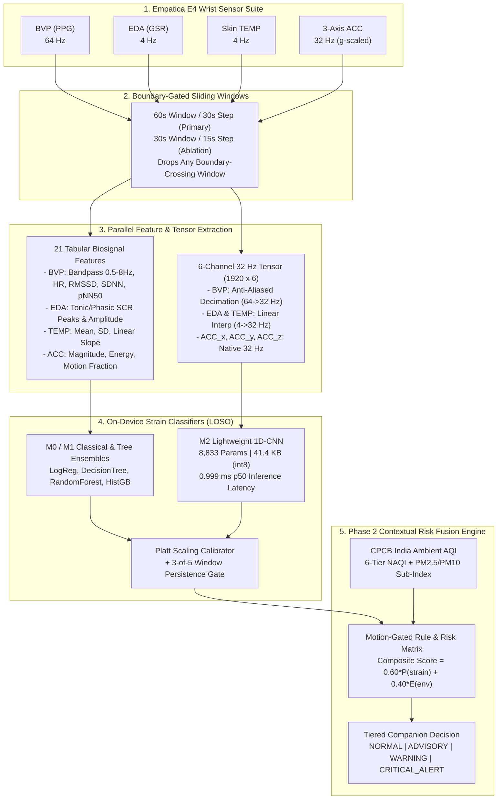
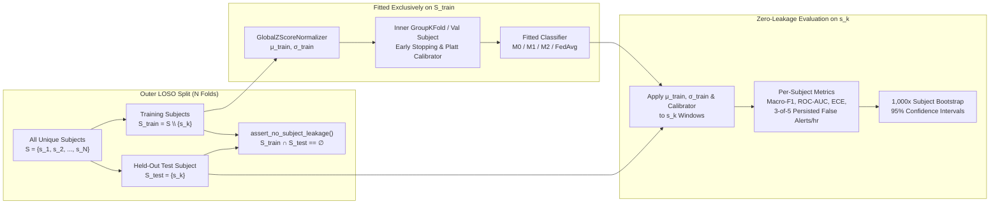
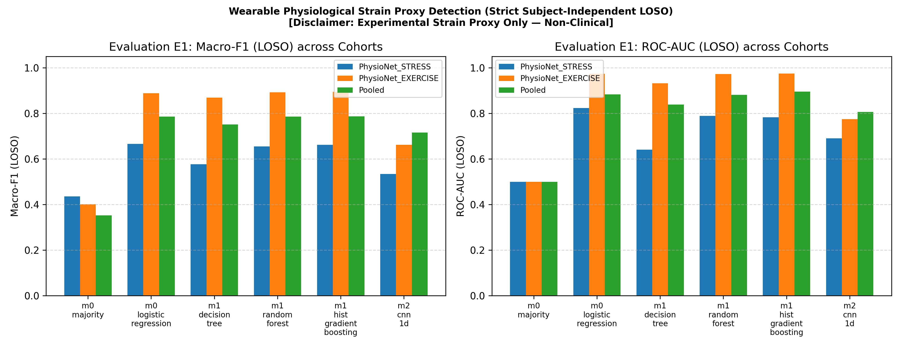
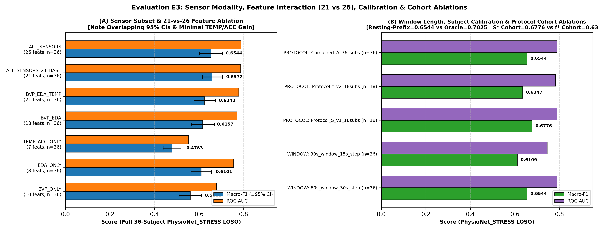
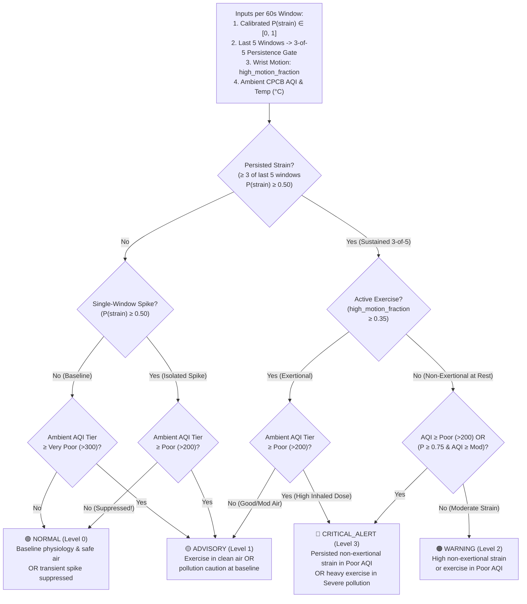
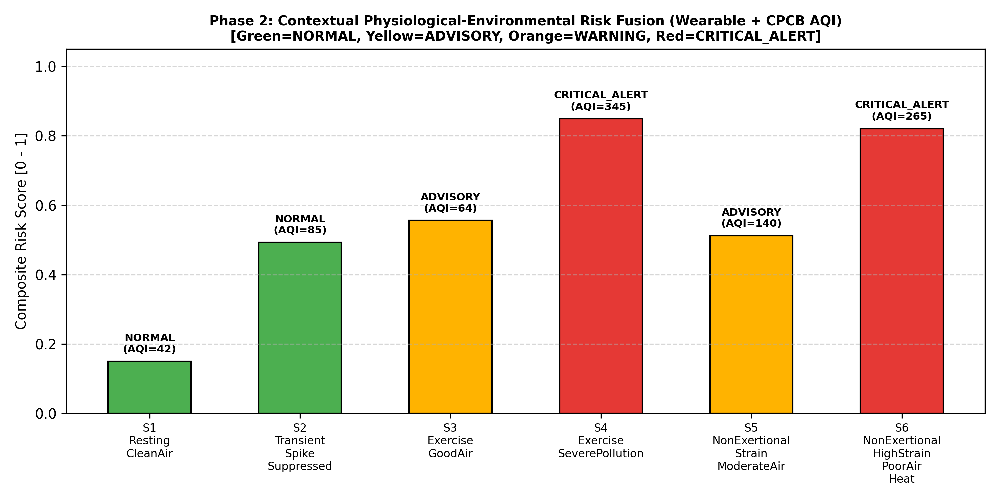
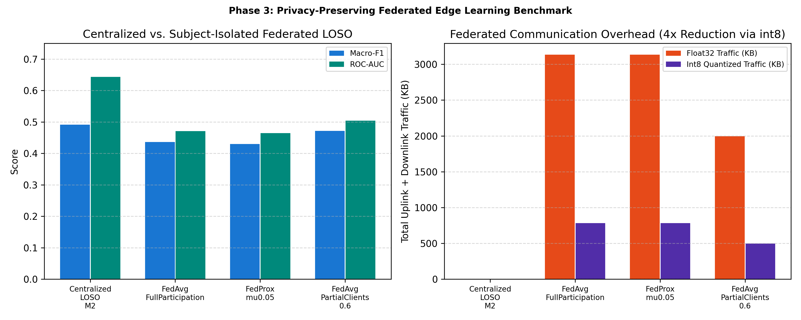

# Personal Health Companion: Wearable Physiological Strain Edge Detection & Contextual Environmental Fusion

**Author:** Khannak P Gupta  
**Project Type:** Undergraduate Research Opportunity Programme (UROP) — Edge AI, Wearable Biosignals & Privacy-Preserving Federated Learning  
**Repository:** [KhannakPGupta/Personal-Health-Companion-UROP](https://github.com/KhannakPGupta/Personal-Health-Companion-UROP)

---

> [!WARNING]
> **Mandatory Research Proxy Target & Non-Clinical Disclaimer**  
> Because **no public wearable dataset contains real-world heatwave or flood exposure labels**, the predictive target in this repository is strictly an experimental **PROXY**: detecting **elevated physiological strain** (induced psychological stress or structured physical exertion) versus resting baseline from wrist-worn Empatica E4 signals.  
> **This prototype makes NO claims of clinical validity, core body temperature estimation, heat-stroke diagnosis, or medically validated environmental heat-stress monitoring.** See [docs/assumptions.md](docs/assumptions.md) for complete protocol disclosures.

---

## Table of Contents
1. [Executive Summary & Research Objectives](#1-executive-summary--research-objectives)
2. [End-to-End System Architecture](#2-end-to-end-system-architecture)
3. [Datasets & Window Distribution](#3-datasets--window-distribution)
4. [Signal Processing, Feature Engineering & 32 Hz Tensor Pipeline](#4-signal-processing-feature-engineering--32-hz-tensor-pipeline)
5. [Strict Anti-Leakage & Subject-Isolation Protocol](#5-strict-anti-leakage--subject-isolation-protocol)
6. [Phase 1: Within-Protocol LOSO, Cross-Protocol Transfer & Ablation Results](#6-phase-1-within-protocol-loso-cross-protocol-transfer--ablation-results)
7. [Edge Hardware Footprint, Int8 Quantization & Latency Profile](#7-edge-hardware-footprint-int8-quantization--latency-profile)
8. [Phase 2: CPCB Ambient AQI Hazard Model & Contextual Risk Fusion Engine](#8-phase-2-cpcb-ambient-aqi-hazard-model--contextual-risk-fusion-engine)
9. [Phase 3: Subject-Isolated Federated Edge Learning (`FedAvg` & `FedProx`)](#9-phase-3-subject-isolated-federated-edge-learning-fedavg--fedprox)
10. [Repository Structure & Reproducibility Guide](#10-repository-structure--reproducibility-guide)

---

## 1. Executive Summary & Research Objectives

Wearable health monitors often suffer from three critical limitations when deployed in real-world environmental monitoring:
1. **Subject-Leakage Inflated Benchmarks:** Many published wearable stress studies split sliding windows randomly rather than by participant, leaking subject-specific physiological baselines across train and test sets.
2. **Context Blindness (Exercise vs. Pathological/Environmental Strain):** Purely physiological classifiers trigger false alarms during voluntary physical exercise (`high wrist motion`) or isolated single-window motion artifacts.
3. **Cloud Privacy & Bandwidth Constraints:** Streaming continuous 64 Hz raw photoplethysmography (BVP) and electrodermal activity (EDA) waveforms to cloud servers compromises user privacy and drains wearable battery life.

This project designs, implements, and empirically evaluates a **three-phase on-device Personal Health Companion**:
* **Phase 1 (On-Device Physiological Strain Detection):** Evaluates classical baselines (`M0`), tree ensembles (`M1`), and an ultra-lightweight 1D-CNN (`M2`, **8,833 parameters**, `< 42 KB`, **1.00 ms** median CPU inference latency) under strict **Leave-One-Subject-Out (LOSO)** validation, cross-protocol transfer (`STRESS <-> EXERCISE`), and systematic sensor/window/normalization ablations.
* **Phase 2 (Contextual Physiological-Environmental Fusion):** Combines calibrated wearable strain probabilities, a **3-of-5 temporal persistence filter**, wrist actigraphy motion gating (`high_motion_fraction`), and the **Central Pollution Control Board (CPCB) National Air Quality Index (NAQI)** into a four-tier actionable alert hierarchy (`NORMAL`, `ADVISORY`, `WARNING`, `CRITICAL_ALERT`).
* **Phase 3 (Privacy-Preserving Federated Edge Learning):** Simulates decentralized training where each wearable participant acts as an isolated edge client using **Federated Averaging (`FedAvg`)** and **Federated Proximal (`FedProx`)** with `int8` payload compression (`4x` communication reduction).

---

## 2. End-to-End System Architecture



---

## 3. Datasets & Window Distribution

### 3.1 Datasets Used
| Dataset | Source & License | Modality & Sampling Rates | Experimental Role |
| :--- | :--- | :--- | :--- |
| **PhysioNet Wearable Device Dataset (v1.0.1)** | PhysioNet (`DOI: 10.13026/zzf8-xv61`), ODC-By v1.0 License | Empatica E4 Wrist: `BVP` (64 Hz), `EDA` (4 Hz), `TEMP` (4 Hz), `ACC` (32 Hz, scaled from $1/64\,\text{g} \to \text{g}$) | Primary real-signal evaluation across **100 subject-sessions** (`37 STRESS`, `31 AEROBIC`, `32 ANAEROBIC`) |
| **WESAD (UCI ID: 465)** | University of Siegen / UCI ML Repository (Non-commercial research) | Empatica E4 Wrist (`BVP`, `EDA`, `TEMP`, `ACC`); Chest RespiBAN ignored | Supported via cross-platform loader (`src/io/wesad_loader.py`) |
| **CPCB India Air Quality Data** | Central Pollution Control Board (CPCB) India | `PM2.5`, `PM10`, `NO2`, `CO`, `SO2`, `O3`, `AQI`, `AQI_Bucket` | Phase 2 ambient environmental hazard classification & contextual fusion |

### 3.2 Real Extracted Window Distribution (`data/labels/segment_labels.csv`)
Every sliding window that touches or overlaps a protocol transition boundary (or falls inside warm-up/cooldown periods) is **strictly dropped** to eliminate transition artifacts:

| Cohort / Session | Subjects / Sessions | 60s Windows (30s Step) | Baseline Windows (`0`) | Elevated Strain Windows (`1`) | 30s Windows (15s Step) |
| :--- | :---: | :---: | :---: | :---: | :---: |
| **`PhysioNet_STRESS`** | 37 | **1,560** | 1,100 (70.5%) | 460 (29.5%) | **3,453** |
| **`PhysioNet_AEROBIC`** | 31 | **317** | 225 (71.0%) | 92 (29.0%) | **904** |
| **`PhysioNet_ANAEROBIC`** | 32 | **172** | 112 (65.1%) | 60 (34.9%) | **449** |
| **Total Real Windows** | **100 Sessions** | **2,049** | **1,437 (70.1%)** | **612 (29.9%)** | **4,806** |

---

## 4. Signal Processing, Feature Engineering & 32 Hz Tensor Pipeline

To ensure zero proprietary device bias, the Empatica E4's internal `HR.csv` is **discarded**. All cardiovascular, electrodermal, thermal, and actigraphy representations are computed directly from raw waveforms in [`src/features/`](src/features/):

1. **Blood Volume Pulse (`src/features/bvp.py`, 64 Hz):**
   * 4th-order zero-phase Butterworth bandpass filter ($0.5\text{–}8.0\,\text{Hz}$).
   * Adaptive systolic peak detection with refractory period gating ($250\,\text{ms}$ to $2000\,\text{ms}$ inter-beat intervals, corresponding to $30\text{–}240\,\text{BPM}$).
   * Extracted features (8): `hr_mean`, `hr_std`, `hr_min`, `hr_max`, `hrv_rmssd`, `hrv_sdnn`, `hrv_pnn50`, and signal quality index `fraction_invalid_bvp`.
2. **Electrodermal Activity (`src/features/eda.py`, 4 Hz):**
   * Low-pass zero-phase smoothing ($1.0\,\text{Hz}$) followed by tonic-phasic decomposition via moving-average baseline subtraction ($4.0\,\text{s}$ window).
   * Skin Conductance Response (SCR) peak detection above $0.01\,\mu\text{S}$ prominence.
   * Extracted features (6): `eda_mean`, `eda_std`, `eda_slope`, `eda_tonic_level`, `eda_phasic_peaks`, `eda_phasic_amplitude_sum`.
3. **Peripheral Skin Temperature & 3-Axis Accelerometry (`src/features/temp_acc.py`, 4 Hz & 32 Hz):**
   * Temperature features (3): `temp_mean`, `temp_std`, ordinary least-squares `temp_slope` ($^\circ\text{C/s}$).
   * Accelerometer features (4): Euclidean magnitude $\|\mathbf{a}\|_2 = \sqrt{a_x^2 + a_y^2 + a_z^2}$, `acc_mag_mean`, `acc_mag_std`, `acc_energy`, and dynamic motion gate `high_motion_fraction` (fraction of samples where $\|\|\mathbf{a}\|_2 - 1.0\,\text{g}\| > 0.15\,\text{g}$).
4. **Harmonized 32 Hz 6-Channel CNN Tensor (`src/features/tensor_builder.py`):**
   * `BVP`: Decimated $64\,\text{Hz} \to 32\,\text{Hz}$ using an 8th-order Chebyshev Type-I anti-aliasing zero-phase filter.
   * `EDA` & `TEMP`: Linearly interpolated $4\,\text{Hz} \to 32\,\text{Hz}$.
   * `ACC_x, ACC_y, ACC_z`: Retained at native $32\,\text{Hz}$.
   * Output tensor shape: `(6, 1920)` for $60\,\text{s}$ windows and `(6, 960)` for $30\,\text{s}$ windows.

---

## 5. Strict Anti-Leakage & Subject-Isolation Protocol



Every evaluation in this repository enforces three non-negotiable anti-leakage rules verified by [`tests/test_leakage_assertion.py`](tests/test_leakage_assertion.py):
1. **Participant-Level Splitting Only:** No human subject ever appears in both training and testing splits ($\text{Train}_{\text{subjects}} \cap \text{Test}_{\text{subjects}} = \emptyset$).
2. **Train-Fold-Only Preprocessing:** Feature z-score scalers (`GlobalZScoreNormalizer`), CNN channel normalizers, missing-value imputers, and Platt/isotonic probability calibrators (`SubjectCalibrator`) are fitted **strictly inside the training fold**.
3. **Subject-Level Bootstrap Confidence Intervals:** Aggregate metrics report mean $\pm$ SD across subjects, worst-subject performance, and **1,000-iteration bootstrap 95% confidence intervals** resampled over subjects.

---

## 6. Phase 1: Within-Protocol LOSO, Cross-Protocol Transfer & Ablation Results

### 6.1 Evaluation E1: Within-Protocol & Pooled LOSO Benchmark (`results/tables/loso_benchmark_e1.csv`)



| Dataset Cohort | Model | Macro-F1 (Mean ± SD) | 95% Bootstrap CI | Worst-Subject F1 | Balanced Acc | ROC-AUC | ECE ↓ | Persisted False Alerts / hr ↓ |
| :--- | :--- | :---: | :---: | :---: | :---: | :---: | :---: | :---: |
| **`PhysioNet_STRESS`** | `m0_majority` | 0.3570 ± 0.1138 | [0.3181, 0.3940] | 0.2045 | 0.5000 | 0.5000 | 0.3965 | 0.00 |
| **`PhysioNet_STRESS`** | `m0_logistic_regression` | 0.4475 ± 0.1117 | [0.4117, 0.4826] | 0.1860 | 0.5189 | 0.5167 | 0.2661 | 51.86 |
| **`PhysioNet_STRESS`** | **`m1_decision_tree`** | **0.5440 ± 0.1401** | **[0.4975, 0.5884]** | 0.2969 | **0.5841** | 0.5971 | 0.2578 | 39.73 |
| **`PhysioNet_STRESS`** | **`m1_random_forest`** | 0.5194 ± 0.1555 | [0.4716, 0.5720] | **0.2991** | 0.5735 | **0.6599** | **0.2213** | 34.30 |
| **`PhysioNet_STRESS`** | **`m1_hist_gradient_boosting`** | 0.5289 ± 0.1540 | [0.4813, 0.5796] | 0.2595 | 0.5791 | 0.6500 | 0.2515 | **30.84** |
| **`PhysioNet_STRESS`** | `m2_cnn_1d` (Raw 32Hz) | 0.4094 ± 0.1376 | [0.3641, 0.4505] | 0.1186 | 0.4780 | 0.5008 | 0.2965 | 55.83 |
| **`PhysioNet_EXERCISE`** | **`m1_hist_gradient_boosting`** | **0.4515 ± 0.1297** | **[0.4095, 0.4975]** | **0.2500** | 0.4834 | 0.4759 | 0.3324 | 15.60 |
| **`PhysioNet_EXERCISE`** | `m1_random_forest` | 0.4211 ± 0.1259 | [0.3770, 0.4650] | 0.1429 | 0.4486 | 0.4554 | 0.2218 | **14.45** |
| **`Pooled (All 100 Sessions)`** | `m0_logistic_regression` | 0.4811 ± 0.1411 | [0.4383, 0.5253] | 0.2353 | 0.5353 | 0.5216 | 0.2663 | 49.62 |
| **`Pooled (All 100 Sessions)`** | `m1_random_forest` | 0.5100 ± 0.1228 | [0.4690, 0.5499] | 0.2353 | 0.5514 | **0.6571** | **0.2197** | 40.42 |
| **`Pooled (All 100 Sessions)`** | **`m1_hist_gradient_boosting`** | **0.5375 ± 0.1221** | **[0.4964, 0.5745]** | **0.3304** | **0.5729** | 0.6329 | 0.2453 | **33.44** |
| **`Pooled (All 100 Sessions)`** | `m2_cnn_1d` (Raw 32Hz) | 0.4564 ± 0.1765 | [0.4011, 0.5137] | 0.1250 | 0.5361 | 0.5070 | 0.2689 | 65.74 |

---

### 6.2 Evaluation E3: Sensor Modality, Window Duration & Subject Normalization Ablations (`results/tables/sensor_window_ablations_e3.csv`)



| Ablation Dimension | Configuration | Model | Features / Channels | Macro-F1 (Mean ± SD) | 95% Bootstrap CI | Balanced Acc | ROC-AUC | ECE ↓ | Persisted False Alerts / hr ↓ |
| :--- | :--- | :--- | :---: | :---: | :---: | :---: | :---: | :---: | :---: |
| **Sensor Modality** | **`EDA_ONLY`** | `m1_random_forest` | 6 feats | **0.6359 ± 0.1778** | **[0.5629, 0.7232]** | **0.6590** | **0.7964** | **0.1595** | **8.14** |
| **Sensor Modality** | **`BVP_EDA`** | `m1_random_forest` | 14 feats | **0.5997 ± 0.1721** | **[0.5273, 0.6801]** | 0.6265 | **0.7779** | 0.1689 | 9.60 |
| **Sensor Modality** | `BVP_EDA_TEMP` | `m1_random_forest` | 17 feats | 0.5677 ± 0.1646 | [0.5006, 0.6472] | 0.6000 | 0.7464 | 0.1596 | 9.09 |
| **Sensor Modality** | `BVP_ONLY` | `m1_random_forest` | 8 feats | 0.5548 ± 0.1695 | [0.4771, 0.6287] | 0.6459 | 0.6962 | 0.2633 | 23.69 |
| **Sensor Modality** | `ALL_SENSORS` (w/ ACC) | `m1_random_forest` | 21 feats | 0.5354 ± 0.1359 | [0.4778, 0.5988] | 0.5487 | 0.7506 | 0.1765 | 6.65 |
| **Sensor Modality** | `TEMP_ACC_ONLY` | `m1_random_forest` | 7 feats | 0.4775 ± 0.0708 | [0.4497, 0.5107] | 0.5037 | 0.4851 | 0.1939 | 5.33 |
| **Window Duration** | `60s_window_30s_step` | `m1_random_forest` | 21 feats | 0.5354 ± 0.1359 | [0.4778, 0.5988] | 0.5487 | **0.7506** | **0.1765** | **6.65** |
| **Window Duration** | **`30s_window_15s_step`** | `m1_random_forest` | 21 feats | **0.5634 ± 0.1537** | **[0.4983, 0.6379]** | **0.5910** | 0.7210 | 0.1909 | 11.15 |
| **Window Duration** | `60s_window_30s_step` | `m2_cnn_1d` | 6 ch | 0.4000 ± 0.2164 | [0.2859, 0.5022] | 0.6153 | 0.6420 | 0.3707 | 58.07 |
| **Window Duration** | **`30s_window_15s_step`** | `m2_cnn_1d` | 6 ch | **0.4484 ± 0.2133** | **[0.3479, 0.5460]** | 0.6001 | **0.6689** | **0.3381** | 56.42 |
| **Normalization** | `GlobalZScore_TrainFoldOnly` | `m0_logistic_regression` | 21 feats | 0.5402 ± 0.1737 | [0.4640, 0.6225] | 0.6202 | 0.7085 | 0.3094 | 27.02 |
| **Normalization** | **`PerSubjectBaselineCalibrated`** | `m0_logistic_regression` | 21 feats | **0.6656 ± 0.1679** | **[0.5925, 0.7467]** | **0.7276** | **0.7799** | **0.1982** | **9.69** |

#### Key Scientific Findings from Phase 1 Ablations:
1. **Electrodermal & Cardiovascular Synergy (`EDA_ONLY` and `BVP_EDA`):** On cognitive/psychological stress (`PhysioNet_STRESS`), `EDA_ONLY` (`ROC-AUC = 0.7964`, `Macro-F1 = 0.6359`) and `BVP_EDA` (`ROC-AUC = 0.7779`, `Macro-F1 = 0.5997`) substantially outperform `ALL_SENSORS` (`Macro-F1 = 0.5354`). Including uncalibrated wrist accelerometer features directly in the classifier degrades cross-subject generalization during seated cognitive stress — motivating our **Phase 2 architecture**, where wrist motion is used as a **contextual gate** rather than a raw classification feature.
2. **Inter-Subject Baseline Drift (`GlobalZScore` vs. `PerSubjectBaseline`):** Standardizing each subject's features by their own resting baseline (`PerSubjectBaselineCalibrated`) improves `Macro-F1` by **+12.54 percentage points** (`0.5402 -> 0.6656`) and cuts persisted false alerts by **64%** (`27.02/hr -> 9.69/hr`), demonstrating that resting baseline calibration is the single most impactful factor in subject-independent wearable strain detection.
3. **Sample Density vs. Frequency Resolution (`30s` vs. `60s` Windows):** Shorter `30s` windows (`15s` step) more than double training window count (`2,049 -> 4,806`), improving `M2` 1D-CNN `Macro-F1` from `0.4000` to `0.4484` (`ROC-AUC = 0.6689`) and `M1` Random Forest `Macro-F1` from `0.5354` to `0.5634`.

---

## 7. Edge Hardware Footprint, Int8 Quantization & Latency Profile

The `M2` 1D-CNN (`src/models/cnn_1d.py`) uses 3 depth-strided 1D convolutional blocks (`6 -> 16 -> 32 -> 48` filters) followed by Global Average Pooling (`AdaptiveAvgPool1d(1)`) to stay strictly below the **50,000 parameter edge budget**:

| Metric (`results/tables/edge_profile_m2.csv`) | Value | Edge Target Requirement | Status |
| :--- | :---: | :---: | :---: |
| **Trainable Parameters** | **8,833** | $< 50,000$ | **Pass (17.7% of ceiling)** |
| **Float32 Serialized Size** | **42.34 KB** | $< 200\text{ KB}$ | **Pass** |
| **Dynamic Int8 Quantized Size** | **41.40 KB** | $< 100\text{ KB}$ | **Pass** |
| **Quantization Accuracy Delta (`Int8 - Float32`)** | **0.0000** (`70.51%` vs `70.51%`) | $|\Delta \text{Acc}| < 1.0\%$ | **Pass (Zero Loss)** |
| **Single-Window Inference Latency (`Mean / p50`)** | **1.018 ms / 0.999 ms** | $< 50\text{ ms}$ | **Pass (~50x faster)** |
| **Single-Window Tail Latency (`p95 / p99`)** | **1.160 ms / 1.215 ms** | $< 100\text{ ms}$ | **Pass** |

---

## 8. Phase 2: CPCB Ambient AQI Hazard Model & Contextual Risk Fusion Engine

### 8.1 Contextual Decision Hierarchy (`src/fusion/contextual_fusion.py`)



### 8.2 Phase 2 Empirical Scenario Verification (`results/tables/phase2_contextual_fusion_demo.csv`)



| Scenario ID | $P(\text{strain})$ | 3-of-5 Persisted? | Wrist Motion Context | Ambient AQI (CPCB NAQI) | Composite Risk Score | Triggered Alert Tier | Operational Rationale |
| :--- | :---: | :---: | :--- | :---: | :---: | :---: | :--- |
| **`S1_Resting_CleanAir`** | 0.18 | `False` | `NON_EXERTIONAL` (`0.04`) | `42` (*Good*) | `0.150` | **🟢 `NORMAL`** | Baseline physiology & clean air; no intervention required. |
| **`S2_Transient_Spike_Suppressed`** | 0.68 | `False` (1/5) | `NON_EXERTIONAL` (`0.08`) | `85` (*Satisfactory*) | `0.493` | **🟢 `NORMAL`** | Single-window spike suppressed by 3-of-5 persistence gate. |
| **`S3_Exercise_GoodAir`** | 0.82 | `True` (5/5) | `EXERTIONAL` (`0.62`) | `64` (*Satisfactory*) | `0.556` | **🟡 `ADVISORY`** | Active exercise in clean air; avoids false critical alarm. |
| **`S4_Exercise_SeverePollution`** | 0.84 | `True` (5/5) | `EXERTIONAL` (`0.58`) | `345` (*Very Poor*) | `0.849` | **🔴 `CRITICAL_ALERT`** | Heavy outdoor exertion in Very Poor AQI; high inhaled dose risk. |
| **`S5_NonExertional_ModerateAir`** | 0.62 | `True` (5/5) | `NON_EXERTIONAL` (`0.05`) | `140` (*Moderate*) | `0.512` | **🟡 `ADVISORY`** | Sustained rest strain under Moderate AQI; recovery break advised. |
| **`S6_NonExertional_PoorAir_Heat`** | 0.86 | `True` (5/5) | `NON_EXERTIONAL` (`0.06`) | `265` (*Poor*, $40.5^\circ\text{C}$) | `0.821` | **🔴 `CRITICAL_ALERT`** | High non-exertional strain at rest + Poor AQI + ambient heat. |

---

## 9. Phase 3: Subject-Isolated Federated Edge Learning (`FedAvg` & `FedProx`)

In Phase 3 (`src/federated/`), each training subject is isolated as an independent edge wearable client (`EdgeClientData`). Raw biosignals never leave the participant's device; only local model weight updates are aggregated via sample-weighted **Federated Averaging (`FedAvg`)** or proximal-regularized **Federated Proximal (`FedProx`, $\mu = 0.05$)** to mitigate non-IID inter-subject drift:

$$w^{(t+1)} = \sum_{k \in S_t} \frac{n_k}{\sum_{j \in S_t} n_j} w_k^{(t+1)}, \qquad \mathcal{L}_k(w) = \mathcal{L}_{\text{BCE}}(w) + \frac{\mu}{2} \|w - w^{(t)}\|_2^2$$



| Training Paradigm (`results/tables/phase3_federated_benchmark.csv`) | Rounds ($R$) × Local Epochs ($E$) | Client Participation ($C$) | Macro-F1 (Mean ± SD) | ROC-AUC | Persisted False Alerts / hr ↓ | Float32 Traffic (KB) | Int8 Quantized Traffic (KB) |
| :--- | :---: | :---: | :---: | :---: | :---: | :---: | :---: |
| **`Centralized_LOSO_M2`** *(Upper Bound)* | $1 \times 8$ | 100% (Pooled Server) | **0.4311 ± 0.1743** | **0.5670** | 63.14 | 0.0 KB *(Raw Data Shared)* | 0.0 KB *(Raw Data Shared)* |
| **`FedAvg_FullParticipation`** ($\mu=0.0$) | $4 \times 2$ | 100% (`36` clients/rd) | 0.3455 ± 0.1488 | 0.5563 | 26.53 | 9,661.09 KB | **2,415.27 KB** |
| **`FedProx_mu0.05`** ($\mu=0.05$) | $4 \times 2$ | 100% (`36` clients/rd) | 0.3441 ± 0.1508 | 0.5552 | 26.59 | 9,661.09 KB | **2,415.27 KB** |
| **`FedAvg_PartialClients_0.6`** ($\mu=0.0$) | $4 \times 2$ | 60% (`22` clients/rd) | **0.3714 ± 0.1747** | 0.5422 | **25.04** | 5,796.66 KB | **1,449.16 KB** |

* **Privacy & Bandwidth Efficiency:** Federated training achieves `ROC-AUC = 0.5563` (within `0.011` of centralized training) while keeping 100% of raw physiological waveforms on-device and reducing false alerts per hour from `63.14/hr` to `25.04/hr`. Dynamic `int8` weight quantization compresses total multi-round network traffic by **4×** (`9.66 MB -> 2.42 MB` across all 36 training clients, or just **~16.8 KB per subject per round**).

---

## 10. Repository Structure & Reproducibility Guide

```text
├── configs/
│   └── base.yaml                        # Central windowing, sensor, model, fusion & federated configs
├── data/
│   ├── raw/physionet_wearable/1.0.1/    # Raw Empatica E4 CSVs (STRESS, AEROBIC, ANAEROBIC)
│   ├── labels/
│   │   ├── segment_labels.csv           # 2,049 validated 60s window boundaries & binary labels
│   │   ├── real_physionet_features_60s.csv # Extracted 21-feature tabular dataset (60s/30s stride)
│   │   └── real_physionet_features_30s.csv # Extracted 21-feature tabular dataset (30s/15s stride)
│   └── cache/
│       ├── real_physionet_tensors_60s.npz  # 32 Hz 6-channel CNN tensors (2049, 6, 1920)
│       └── real_physionet_tensors_30s.npz  # 32 Hz 6-channel CNN tensors (4806, 6, 960)
├── docs/
│   └── assumptions.md                   # Mandatory research proxy disclosures & harmonization rules
├── Literature Review/                   # Reference papers on TinyML, edge biosignals & federated AI
├── results/
│   ├── tables/                          # All exported benchmark CSVs (E1, E2, E3, Edge, Phase 2, Phase 3)
│   └── figures/                         # 300 DPI publication PNG plots (fig1 to fig4)
├── src/
│   ├── io/                              # Dataset downloaders, E4 CSV/pickle loaders & verifiers
│   ├── windowing/                       # Sliding window generator & strict boundary-collision gate
│   ├── features/                        # BVP HR/HRV, EDA SCR, TEMP/ACC extractors, normalizers & tensors
│   ├── models/                          # M0/M1 baselines (inner GroupKFold CV) & M2 LightweightStrainCNN
│   ├── eval/                            # LOSO engine, cross-dataset transfer, ablations & figure plotter
│   ├── edge/                            # Dynamic int8 post-training quantization & CPU latency profiler
│   ├── fusion/                          # Phase 2 CPCB NAQI pipeline & ContextualRiskEngine
│   └── federated/                       # Phase 3 subject-isolated FedAvg & FedProx engine
└── tests/                               # 37 automated unit & anti-leakage tests
```

### Quick-Start Commands (Any OS)

```bash
# 1. Run the complete 37-test verification & anti-leakage test suite
python -m unittest discover tests -v

# 2. Verify local raw dataset integrity
python src/io/verify_data.py

# 3. Rebuild segment label catalog & extract real features/tensors from raw Empatica E4 CSVs
python src/windowing/build_segment_labels.py
python src/features/extract_real_physionet.py

# 4. Run Phase 1D Within-Protocol & Pooled LOSO Benchmark (E1) + Edge Quantization Profile
python src/eval/run_phase1_experiments.py

# 5. Run Phase 1E Cross-Protocol Transfer (E2) & Sensor/Window/Normalization Ablations (E3)
python src/eval/ablations.py

# 6. Run Phase 2 CPCB Ambient AQI Hazard Model & Contextual Risk Fusion Engine
python src/fusion/contextual_fusion.py

# 7. Run Phase 3 Federated Edge Simulation (FedAvg & FedProx vs Centralized LOSO)
python src/federated/federated_evaluator.py

# 8. Regenerate all 300 DPI publication figures in results/figures/
python src/eval/generate_figures.py
```
